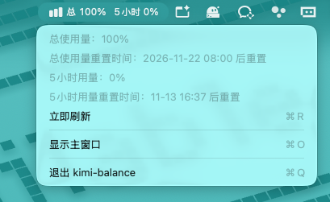

# kimi-balance

一款原生 macOS 菜单栏应用，用于展示 Kimi 订阅的总使用量和 5 小时用量。

## 界面预览



## 功能

- 菜单栏实时显示总使用量和 5 小时用量。
- 点击菜单栏图标可查看两项用量及各自的重置时间。
- 每 60 秒自动刷新，也可以点击“立即刷新”手动更新。
- 主窗口关闭后，后台仍会持续刷新数据。
- 启动时只显示菜单栏，不自动打开主窗口。
- 主窗口采用单窗口模式；再次打开时会复用并置前显示已有窗口。
- 仅主窗口显示时展示 Dock 图标，关闭主窗口后自动隐藏。

## 登录与数据

应用使用 `WKWebView` 的持久化数据存储保存登录 Cookie，不会读取 Chrome 或其他浏览器的 Cookie。

首次使用或登录失效时：

1. 点击菜单栏图标，选择“显示主窗口”。
2. 在主窗口打开的 `kimi.com` 页面中完成登录。
3. 点击“登录完成，查看用量”。

登录有效时，应用通过不展示的后台 WebView 访问以下页面并提取用量数据：

```text
https://www.kimi.com/settings/subscription
```

只要 Cookie 仍然有效，后续启动会直接复用登录状态。Cookie 仅保存在 WebView 的本地数据存储中。

## 构建与运行

要求：

- macOS 26.6.2 或更高版本
- Xcode 27 或兼容版本

打开项目并运行：

```bash
open kimi-balance.xcodeproj
```

也可以使用命令行构建：

```bash
xcodebuild -project kimi-balance.xcodeproj \
  -scheme kimi-balance \
  -configuration Debug \
  -destination 'platform=macOS' \
  build
```

应用启用了 App Sandbox，仅包含网络客户端权限。

## 主要代码

- `kimi-balance/MyApp.swift`：应用启动、主窗口复用和 Dock 图标管理。
- `kimi-balance/StatusBarController.swift`：原生菜单栏图标、文字及下拉菜单。
- `kimi-balance/ContentView.swift`：登录页面、用量展示、后台刷新与数据提取。
