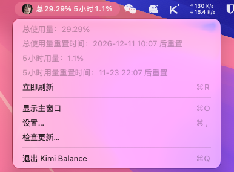

# Kimi Balance

一款原生 macOS 菜单栏应用，用于展示 Kimi 订阅的总使用量和 5 小时用量，并在后台自动刷新数据。

- 当前版本：1.4 (5)
- GitHub：[LunaGao/kimi-balance](https://github.com/LunaGao/kimi-balance)
- 下载：[Releases](https://github.com/LunaGao/kimi-balance/releases)

## 界面预览



## 功能

- 菜单栏实时显示总使用量和 5 小时用量。
- 点击菜单栏图标可查看两项用量及各自的重置时间。
- 默认每 60 秒自动刷新，可在设置中调整为 30 秒至 30 分钟，也可以点击“立即刷新”手动更新。
- 主窗口关闭后，后台仍会持续刷新数据。
- 启动时只显示菜单栏，不自动打开主窗口。
- 主窗口采用单窗口模式；再次打开时会复用并置前显示已有窗口。
- 主窗口或设置窗口显示时展示 Dock 图标，全部关闭后自动隐藏。
- 设置页可多选状态栏展示内容：头像、文字和双圆形进度条可自由组合，并可拖动调整排列顺序。
- 支持中文和英文，默认跟随系统首选语言；在设置中切换后立即生效，无需重启。
- 支持开机自动启动，默认开启，可在设置中关闭。
- 设置页提供中英文操作指南、版本号、构建号、GitHub 仓库和数据来源入口。
- 使用 Sparkle 检查应用更新，发现新版本时在菜单栏显示更新提醒。

## 使用说明

### 1. 启动应用

从 [Releases](https://github.com/LunaGao/kimi-balance/releases) 下载并打开 Kimi Balance，或按照下方“构建与运行”章节自行构建。

启动后，应用图标和用量信息会出现在 macOS 菜单栏中，不会自动打开主窗口。

### 2. 登录 Kimi

首次使用或登录状态失效时，菜单栏会显示“请完成登录”：

1. 点击菜单栏中的 Kimi Balance。
2. 选择“显示主窗口”。
3. 在主窗口打开的 `kimi.com` 页面中完成登录。
4. 点击“登录完成，查看用量”。

只要登录 Cookie 仍然有效，后续启动会直接复用登录状态，无需重复登录。

### 3. 查看用量

登录成功后，菜单栏会直接显示总使用量和 5 小时用量。点击菜单栏区域可查看：

- 总使用量及其重置时间。
- 5 小时用量及其重置时间。
- 刷新、主窗口、设置、检查更新和退出等操作。

### 4. 刷新数据

应用默认每 60 秒自动刷新一次。可在设置的“General”页通过滑块调整刷新频率，范围为 30 秒至 30 分钟，步长为 30 秒。需要立即获取最新数据时，可通过以下任一方式刷新：

- 点击菜单栏中的“立即刷新”。
- 在主窗口中点击“立即刷新”。

关闭主窗口不会退出应用，也不会停止后台刷新。

### 5. 打开设置与检查更新

点击菜单栏中的“设置…”，可以配置界面语言、状态栏展示内容，并查看：

- 在“通用 / General”页的“语言 / Language”选项中选择中文或英文。
- 头像、文字和双圆形进度条可多选并自由组合；两个圆环分别表示总使用量和 5 小时用量。
- 中英文操作流程（使用指南 / How to Use）。
- 应用版本号和构建号。
- GitHub 仓库与 Kimi 订阅数据来源链接。
- 登录 Cookie 和用量数据的简要说明。

选择“检查更新…”可通过 Sparkle 检查新版本。选择“退出 Kimi Balance”可完全退出应用并停止后台刷新。

## 多语言

应用界面支持简体中文和英文，首次启动时根据 macOS 的首选语言自动选择。点击菜单栏中的“设置… / Settings…”，在“通用 / General”页通过“语言 / Language”选择器即可切换。

语言设置会保存在应用偏好设置中，并立即应用到主窗口、设置页、菜单栏用量详情及操作菜单，无需重启应用。Kimi 网页内的语言由 Kimi 网站自身控制。

## 登录与数据

应用使用 `WKWebView` 的持久化数据存储保存登录 Cookie，不会读取 Chrome、Safari 或其他浏览器的 Cookie。Cookie 仅保存在应用本地的 WebView 数据存储中。

登录有效时，应用通过不展示的后台 WebView 访问以下页面并提取用量数据：

```text
https://www.kimi.com/settings/subscription
```

应用不会修改订阅数据。用量信息和重置时间以 Kimi 订阅页面显示的内容为准。

## 常见问题

### 菜单栏一直显示“请完成登录”

重新打开主窗口，确认已在当前应用内置页面完成 Kimi 登录，然后点击“登录完成，查看用量”。仅在独立浏览器中登录不会同步到应用。

### 用量显示为 `--`

这通常表示登录已失效、订阅页面尚未加载完成，或页面内容暂时无法读取。请先确认登录状态，再点击“立即刷新”；如果仍无法恢复，请重新登录。

### 主窗口关闭后找不到应用

应用仍在菜单栏运行。点击菜单栏中的用量信息，选择“显示主窗口”即可重新打开；如需完全退出，请选择“退出 Kimi Balance”。

## 构建与运行

要求：

- macOS 26.6.2 或更高版本
- Xcode 27 或兼容版本

打开项目并运行：

```bash
open kimi-balance.xcodeproj
```

也可以使用命令行构建：

```bash
xcodebuild -project kimi-balance.xcodeproj \
  -scheme kimi-balance \
  -configuration Debug \
  -destination 'platform=macOS' \
  build
```

应用启用了 App Sandbox，仅包含网络客户端权限。Sparkle 依赖由 Xcode Swift Package Manager 自动解析。

## 主要代码

- `kimi-balance/MyApp.swift`：应用启动、设置场景、主窗口复用和 Dock 图标管理。
- `kimi-balance/StatusBarController.swift`：原生菜单栏图标、文字及下拉菜单。
- `kimi-balance/ContentView.swift`：登录页面、用量展示、后台刷新与中英文数据提取。
- `kimi-balance/SettingsView.swift`：语言选择、应用设置、操作流程、版本信息及项目链接。
- `kimi-balance/Localization.swift`：语言偏好与中英文文案解析。
- `kimi-balance/Localizable.xcstrings`：中文、英文本地化资源。
